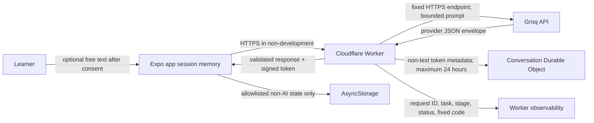

# Security and PHI-readiness boundary

> **NOT VERIFIED FOR REAL PHI.** This is an implementation-readiness record, not a HIPAA compliance determination, clinical validation, security certification, legal opinion, or authorization to collect participant data.

Status: 2026-08-26. Scope: Expo client, Cloudflare Worker, Groq provider boundary, local persistence, and operational diagnostics.

## Architecture and trust boundaries

The app has no direct provider credential. The Worker owns the fixed provider endpoint, model allowlist, strict schemas, safety policy, knowledge/evidence selection, HMAC-signed conversation state, provider timeout, response validation, provenance validation, exact CORS, security headers, and operational logging. No provider tools, browsing, web search, files, or code execution are enabled. Groq's current model catalog is documented at [Groq supported models](https://console.groq.com/docs/models), and Groq's built-in-tool behavior is documented at [Groq built-in tools](https://console.groq.com/docs/tool-use/built-in-tools). Model availability was checked separately, but account entitlement and future availability remain operational dependencies.

## Field-level data flow

| Field/category | App -> Worker | Worker -> Groq | Returned or retained |
| --- | --- | --- | --- |
| `moduleId`, `screenId`, `lessonId`, optional `activityId`, `kind` | Current allowlisted lesson context | Used to select bounded server-side context; identifiers may be represented in task context | Not written to AI transcript storage; learning progress IDs may exist independently in allowlisted AsyncStorage |
| `locale` (`en`/`es`) | Sent after consent | Sent to enforce output language | Language preference is retained locally as legitimate learning state |
| `sessionId` | Ephemeral random value | Used for request/session handling, not as participant identity | Session memory only |
| `conversationToken` | Returned after start, then sent on each turn | Verified Worker state is represented in provider task context; raw signing secret is never sent | Opaque token remains in component memory only; the Durable Object retains only module, screen, locale, revision, issue time, and reservation metadata |
| Current learner message and bounded recent messages | Sent only after consent and client limits | Included as untrusted bounded content | Rendered in session memory only; not serialized by the app |
| Rubric, system policy, selected knowledge/evidence excerpts | Not present in client | Added by Worker | Provenance/source IDs returned after validation |
| Provider credential | Never present | Worker sends it only in the provider authorization header | Never returned or logged by application code |
| Request ID | May be received in a response header | Used for Worker/provider-attempt correlation, not prompt content | Allowlisted in operational logs |

Free text can contain health information even though the app tells learners not to enter identifying or private information. Pattern checks and strict schemas reduce obvious misuse but cannot reliably identify or remove all PHI. Consent and warning copy are therefore necessary safeguards, not de-identification guarantees.

## Endpoint and encryption boundary

Expo states that `EXPO_PUBLIC_` values are embedded in the client and must not hold secrets: [Expo environment variables](https://docs.expo.dev/guides/environment-variables/). EAS documents how environment values are selected and made available during builds: [EAS environment variables](https://docs.expo.dev/eas/environment-variables/usage/).

- Web development may use `http://127.0.0.1:8789`.
- Expo Go/native development can derive `http://<Metro LAN host>:8789` only when `EXPO_PUBLIC_AI_NATIVE_DEV_WORKER_PORT` is explicitly set. Native loopback is rejected. This local HTTP path is development-only and is not an encrypted production transport.
- Preview and production require an explicit non-loopback HTTPS shared endpoint. They currently keep AI disabled and contain no endpoint.
- Worker-to-Groq uses the fixed HTTPS Groq API endpoint.

The former public Workers URL is stale relative to the current client contract: health was `200/configured`, while synthetic conversation-start requests returned `400 INVALID_REQUEST` for current lesson contexts. It is not configured or verified. An authorized current Worker deployment is required before preview/production device E2E can pass.

### Local Worker secret path

The canonical development launcher requires Worker development variables at `%LOCALAPPDATA%\LifespanSleepEducation\worker.dev.vars` by default, or at an explicit external path passed with `-WorkerDevVarsPath`. The path must be outside this Google Drive project. The launcher passes it to Wrangler with `--env-file`, fails before starting processes when it is missing, and never prints variable values.

Migration is manual: create the external file from the authorized secret source or password manager, not by copying or reading a project-local secret through application tooling. Confirm local Worker health, then remove any obsolete project-local secret file through the user's approved secure process. This repository does not automate reading, copying, moving, deleting, or displaying an existing secret file. Preview and production AI remain disabled and receive no development secret.

## Local persistence and deletion

Every learning-state write and hydration passes through an explicit allowlist. Retained fields are curriculum version, progress identifiers, answers/attempts, reflections, action plans, language, narration/voice preferences, reduce-motion preference, AI enabled/consent choices, and Vela revision. Historical unknown fields are dropped.

AI transcripts, drafts, signed conversation tokens, and pending Vela `learnerText` are session-memory only. Pending Vela text is separate nonserialized provider state. These values are cleared by their UI/session lifecycle and disappear when the app process ends. Reset/migration can remove the app's AsyncStorage state, but the app cannot guarantee deletion from OS backups, browser profiles, vendor systems, or platform logs.

AsyncStorage learning state is not encrypted by the application. Device storage protection is platform-controlled, and OS/cloud backups may preserve it after an in-app reset. This is a real-PHI blocker unless institutional security approves the stored fields, platform controls, backup behavior, retention, and deletion procedure.

The conversation Durable Object stores no learner message, transcript, response, prompt, identifier, or session ID. It stores only signed-state coordination metadata. Each write schedules deletion at the signed state's 24-hour expiry; expired records are also pruned on initialize/read/reserve, and the alarm deletes the record if no later request occurs.

## Logs and telemetry

Ordinary Worker logs contain only request ID, task, stage, numeric status, and a fixed error/category code. They exclude prompts, learner text, model response content, URLs with queries, headers, authorization tokens, provider bodies, and signing material. Safe client development diagnostics are limited to category, status, and request ID. Cloudflare documents Workers log behavior and configuration at [Workers Logs](https://developers.cloudflare.com/workers/observability/logs/workers-logs/).

No analytics SDK was identified in this scoped flow. Cloudflare account log settings, destinations, retention, access roles, and deletion behavior are **UNVERIFIED**.

## Safeguards implemented in code

- Affirmative AI consent and an independent AI-enabled preference.
- Fail-closed endpoint resolution with no production default.
- Strict request/response schemas and bounded message, body, turn, timeout, and output limits.
- Exact public error categories without relaying provider messages or bodies.
- Server-side model allowlist, fixed provider endpoint, and no provider tools.
- HMAC-signed conversation tokens and server-owned conversation policy.
- Durable Object conversation metadata contains no learner text and expires after at most 24 hours through read-time pruning plus a scheduled alarm.
- Safety, urgent, identifier, scope, language, evidence, source-ID, and provenance checks.
- Exact CORS policy and security headers.
- Isolate-local rate limiting with expired-entry pruning and a hard bucket-cardinality cap, plus bounded upstream retries/fallback.
- Content-free ordinary logs and diagnostics.
- Explicit local persistence allowlist that drops historical AI text.

## Access-control and abuse-control gap

**Release and PHI blocker:** public provider-backed AI access is unauthenticated. There is no participant authentication or authorization layer, so anyone who can reach an enabled public Worker can attempt requests within the exposed route and validation controls. This blocks any release that enables the public provider path and blocks all real-PHI use until an institutionally approved caller-access decision and enforceable production controls are implemented and verified.

CORS restricts cooperative browser origins; it does not authenticate a caller. Client-generated session IDs are correlation values; they do not establish identity. HMAC-signed conversation tokens protect server-owned conversation-state integrity; possession does not identify or authorize a participant. None of these controls substitutes for caller authentication.

The in-process limiter now prunes expired entries and caps isolate-local map cardinality, but it cannot enforce a globally consistent per-caller or per-IP quota across Worker isolates. Distributed/global enforcement requires an approved Cloudflare Rate Limiting configuration, a Durable Object design, or equivalent account-level enforcement. The exact product, account tier, rules, identifiers, retention, and monitoring remain unverified and must be selected through the security/governance review rather than inferred in application code.

## Provider, platform, and governance verification

Groq describes data controls, retention options, and Zero Data Retention at [Your Data](https://console.groq.com/docs/your-data), and publishes a customer BAA document at [Customer Business Associate Addendum](https://console.groq.com/docs/legal/customer-business-associate-addendum). Cloudflare publishes US privacy compliance and BAA information at [US privacy compliance](https://www.cloudflare.com/trust-hub/us-privacy-compliance/). These public pages do not prove that this project's accounts, plans, services, or configuration are covered.

The following are **UNVERIFIED** and must remain treated as blockers for real PHI:

- Groq account-specific ZDR status, retention settings, service tier, regional processing, access controls, and executed BAA.
- Cloudflare account/service BAA coverage, plan/tier, log settings, retention, access controls, deletion behavior, and incident-notification configuration.
- Institutional security/privacy review, data-use terms, retention schedule, deletion workflow, incident-response ownership, IRB determination/approval, and authorization for participant use.
- End-to-end preview/production device behavior against an authorized current Worker deployment.
- Approval of unencrypted local learning-state fields and OS/cloud-backup behavior.

## Readiness decision

The scoped code reduces accidental local retention, fails closed on invalid endpoints, preserves safe diagnostics, and improves failure classification. It does not establish HIPAA compliance or permission to process PHI. Until every account-specific, contractual, institutional, access-control, retention, incident-response, and deployed-E2E item above is verified in writing, use synthetic data only.
